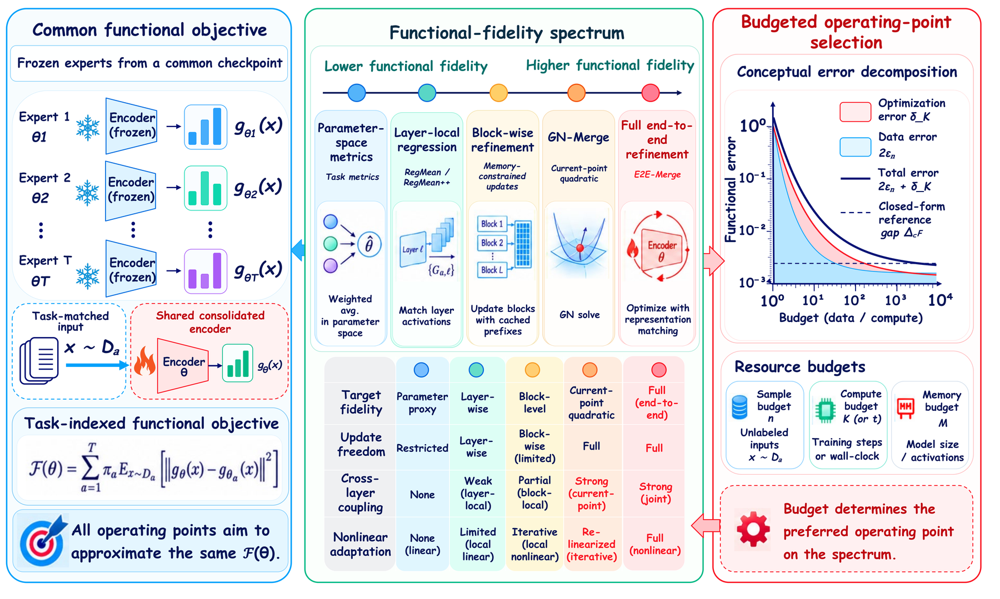
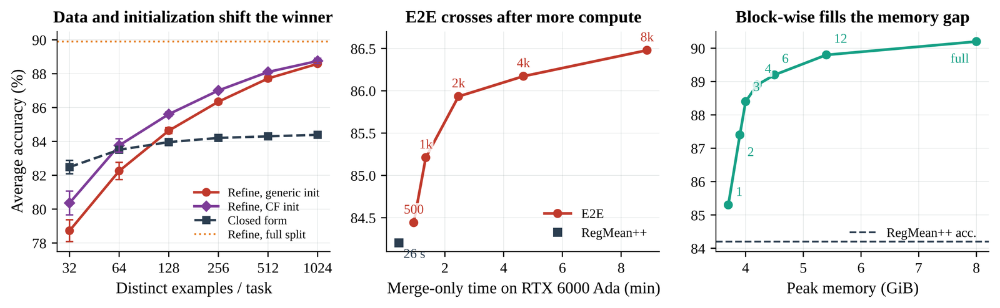

<div align="center">

# Model Consolidation

### When Does Refinement Pay?

**Closed-form merging, Gauss–Newton, block-wise, and end-to-end refinement are budgeted
approximations to one task-indexed functional objective. Exact local excess-loss formulas and a
label-free residual predictor say when higher-fidelity refinement is worth its data, compute, and
memory cost.**

<p align="center">
  <a href="https://gongzhiren.github.io/personal-website/"><strong>Zhiren Gong</strong></a>, Tiantong Wang, Zeng Zihao, Yiyang Duan, Ming Xiao, Chau Yuen, Wei Yang Bryan Lim
</p>

<table>
  <tr>
    <td align="center">
      <a href="#citation"><strong>📄 Read the paper</strong></a><br>
      <sub>Under review · coming soon</sub>
    </td>
    <td align="center">
      <a href="https://gongzhiren.github.io/E2E-website/"><strong>🌐 Explore the project</strong></a><br>
      <sub>Visual story and highlights</sub>
    </td>
    <td align="center">
      <a href="#quick-start"><strong>⚡ Quick start</strong></a><br>
      <sub>Run a merge out of the box</sub>
    </td>
    <td align="center">
      <a href="#a-label-free-signal-for-refinement"><strong>🧩 Label-free signal</strong></a><br>
      <sub>Refine-or-stop, before you train</sub>
    </td>
  </tr>
</table>

[](#citation)
[](https://gongzhiren.github.io/E2E-website/)
[](https://www.python.org)
[](https://pytorch.org)
[](https://github.com/tanganke/fusion_bench)
[](LICENSE)

[Why](#why-model-consolidation) · [Spectrum](#the-operating-point-spectrum) · [Quick start](#quick-start) · [Label-free signal](#a-label-free-signal-for-refinement) · [Citation](#citation)

</div>

<p align="center">
  
</p>

<p align="center"><em>One objective, a fidelity spectrum from parameter-space metrics to end-to-end refinement, and a budget that selects the operating point.</em></p>

## News

- **2026 — initial release.** Reference implementation of the consolidation methods (E2E-Merge, GN-Merge, block-wise) and the label-free refinement predictor.

## Why Model Consolidation?

Model consolidation combines task-specific experts into one deployable model. We treat method
choice as deciding **how faithfully to preserve expert behavior within a resource budget**. Cheap
mergers solve a tractable surrogate; refinement spends data and compute to match expert behavior
more directly. Everything is organized around one **task-indexed functional objective**

```
F(θ) = Σ_a π_a · E_{x∼D_a} || g_θ(x) − g_{θ_a}(x) ||²
```

where `g_θ` is the merged model's final representation and `g_{θ_a}` is expert `a`'s — label-free
(it matches expert outputs, not gold labels) but data-assisted.

<table>
  <tr>
    <td align="center"><strong>One objective</strong><br><sub>every method approximates F</sub></td>
    <td align="center"><strong>4 operating points</strong><br><sub>closed-form → GN → block-wise → E2E</sub></td>
    <td align="center"><strong>Label-free</strong><br><sub>no labels, no test data</sub></td>
    <td align="center"><strong>92.9%</strong><br><sub>refine-or-stop decisions correct</sub></td>
  </tr>
</table>

## The operating-point spectrum

All methods are **drop-in algorithms for [FusionBench](https://github.com/tanganke/fusion_bench)**,
so every point runs under identical data loading, checkpoints, and evaluation. Each rung restores
more of the deployed function at a higher cost, and every point returns **one shared encoder** with
no learned router and the same per-example inference cost.

| Operating point | File | Cost | What it restores |
|---|---|---|---|
| Closed-form (RegMean++) | *FusionBench* | statistics pass + solve | layer-local activation match |
| Current-point quadratic (**GN-Merge**) | `method/e2e_merge/gn_merge.py` | a few matrix-free CG solves | current-point cross-layer geometry |
| Block-wise refinement | `method/e2e_merge/blockwise_e2e_merge.py` | one block group in memory | partial joint scope, memory-controlled |
| End-to-end (**E2E-Merge**) | `method/e2e_merge/clip_e2e_merge.py` | full training trajectory | the full nonlinear objective |

<p align="center">
  
</p>

<p align="center"><em>Three slices of the budget frontier — refinement overtakes the closed-form merge at 128 examples/task, crosses it in seconds of extra compute, and block-wise refinement fills the memory gap.</em></p>

## Installation

```bash
git clone https://github.com/GongZhiren/Model-Consolidation.git
cd Model-Consolidation
python -m venv .venv && source .venv/bin/activate
pip install -r requirements.txt
```

Register the methods with FusionBench, either by copying them into a checkout,

```bash
cp -r method/e2e_merge  <fusion_bench>/fusion_bench/method/
cp    configs/*.yaml     <fusion_bench>/config/method/e2e_merge/
```

or by pointing `FUSIONBENCH_ROOT` at a checkout that already contains them (see
`scripts/env.sh`). The public CLIP experts and datasets are downloaded by FusionBench on first use.

## Quick start

Merge the eight ViT-B/32 CLIP experts with `E2E-Merge` and evaluate under the standard harness:

```bash
fusion_bench \
  method=e2e_merge/clip_e2e_merge \
  method.lr=5.0e-6 method.steps=8000 method.match=proj method.init_scale=0.3 \
  modelpool=CLIPVisionModelPool/clip-vit-base-patch32_TA8 \
  taskpool=CLIPVisionModelTaskPool/clip-vit-classification_TA8 \
  taskpool.base_model=openai/clip-vit-base-patch32
```

| Flag | Default | Meaning |
|------|---------|---------|
| `method.match` | `proj` | target: `proj` (normalized projected rep.), `pool`, or `logit` (KL) |
| `method.steps` | `400` | number of student updates |
| `method.init_scale` | `0.3` | task-arithmetic initialization scale `α` |
| `method.stream` | `true` | `true` fresh minibatch per step; `false` fixed calibration set |
| `method.num_cal_batches` | `8` | fixed-set size per task when `stream=false` (data-budget sweep) |
| `method.init_from` | `null` | path to a saved merge to refine (e.g. a closed-form solution) |
| `method.sam_rho` | `0.0` | `>0` enables sharpness-aware minimization on the logit target |
| `method.seed` | `0` | task-sampling and data-shuffle order |

`GN-Merge` and the block-wise variant use `method=e2e_merge/clip_gn_merge` and
`method=e2e_merge/clip_blockwise_e2e`; see their configs for options.

### Reproducing the paper

[`RESULTS.md`](RESULTS.md) maps every reported number to its command. The `scripts/` drivers wrap
them; edit `scripts/env.sh` (paths and GPU), then:

```bash
source scripts/env.sh
bash scripts/run_endpoints.sh          # accuracy endpoints
bash scripts/run_data_frontier.sh      # data-budget crossover
bash scripts/run_iteration_frontier.sh # update-budget curve
bash scripts/run_blockwise.sh          # memory frontier
bash scripts/run_target_control.sh     # target-by-init and SAM control
```

## A label-free signal for refinement

Before spending any end-to-end budget, measure the closed-form merge's **held-out functional
residual** — no labels, no test data. Across all 70 four-task subsets of the ViT-B/32 pool it tracks
the eventual E2E gain at Spearman `ρ = 0.96`, and under leave-one-task-out calibration predicts the
gain at `0.265`-point RMSE and makes **92.9%** of refine-or-stop decisions correctly (vs 73.9% from
initial accuracy, 57.5% from task-vector cosine). See
[`residual_predictor/README.md`](residual_predictor/README.md).

```bash
python residual_predictor/make_residual_configs.py "$REPO" "$OUT"   # enumerate 70 subsets
python residual_predictor/measure_residual.py "$REPO" s4_00 <merge> "$OUT/residual_s4_00.json"
python residual_predictor/analyze_residual.py "$OUT"                # correlations + decisions
```

## Repository layout

```text
method/e2e_merge/        E2E-Merge, GN-Merge, block-wise, and the Flan-T5 variant
configs/                 Hydra configs for each method
residual_predictor/      Label-free refine-or-stop predictor (measure / analyze / enumerate)
scripts/                 Reproduction drivers (edit env.sh, then run)
RESULTS.md               Command-to-number reproduction map
```

Closed-form baselines (RegMean / RegMean++, Fisher, Iso-C, TSV-M, Task Arithmetic) are
FusionBench's own methods, run under the same pools.

## Citation

```bibtex
@article{gong2026consolidation,
  title   = {Model Consolidation: When Does Refinement Pay?},
  author  = {Gong, Zhiren and Wang, Tiantong and Zeng, Zihao and Duan, Yiyang and Xiao, Ming and Yuen, Chau and Lim, Wei Yang Bryan},
  journal = {Under review},
  year    = {2026}
}
```

## License

Released under the MIT License — see [LICENSE](LICENSE).
